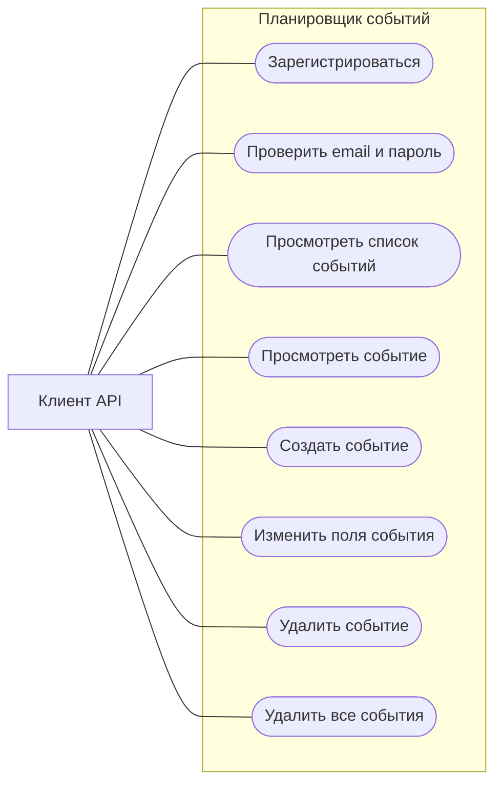

# Варианты использования планировщика

ПЗ №8: клиент работает с FastAPI через Swagger UI или curl. Данные сохраняются
в SQLite. Регистрация и вход проверяют данные пользователя, но не создают
токен или сессию; операции с событиями доступны без входа.

| Сценарий | Запрос | Результат |
| --- | --- | --- |
| Регистрация | `POST /user/signup`, email и пароль | 200; пользователь в SQLite, пароль хеширован; повторный email — 409 |
| Вход | `POST /user/signin`, email и пароль | 200; неизвестный пользователь — 404, неверный пароль — 403 |
| Создание | `POST /event/new`, данные события | 200 и назначенный ID; явный повторный ID — 409 |
| Список | `GET /event/` | 200 и массив событий, пустой массив при отсутствии данных |
| Просмотр | `GET /event/{id}` | 200 и событие; отсутствующее — 404 |
| Обновление | `PUT /event/edit/{id}`, изменяемые поля | 200 и полное обновлённое событие; отсутствующее — 404 |
| Удаление | `DELETE /event/delete/{id}` | 200; повторное удаление — 404 |
| Очистка | `DELETE /event/` | 200; удаляются только события, пользователи сохраняются |

Некорректное тело запроса или неположительный/нецелочисленный ID возвращает 422.
При обновлении пропущенные поля сохраняются, передача `null` отклоняется,
изменение первичного ключа запрещено. Перезапуск приложения не меняет данные.

`User.events` — JSON-снимок, передаваемый при регистрации, без внешнего ключа
и автоматической синхронизации. Владельцы событий, разграничение доступа,
выход и миграции схемы находятся за рамками этой работы.
